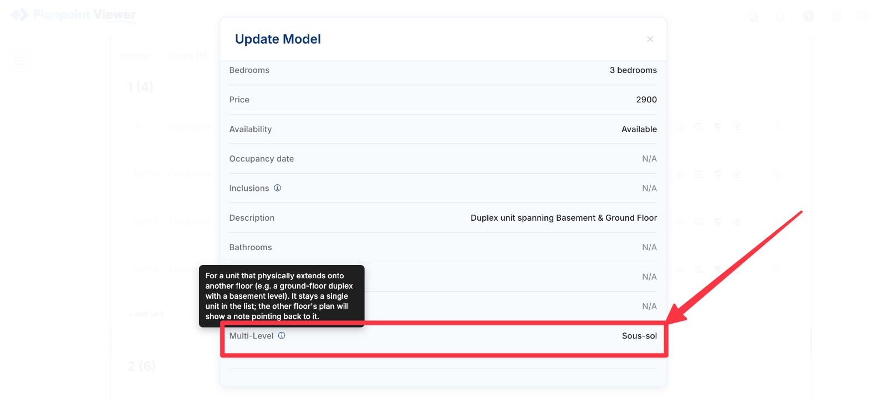
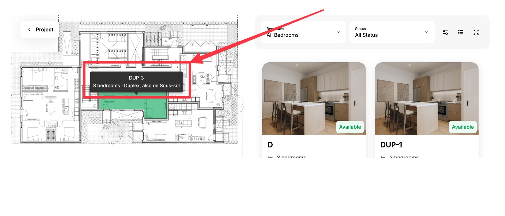
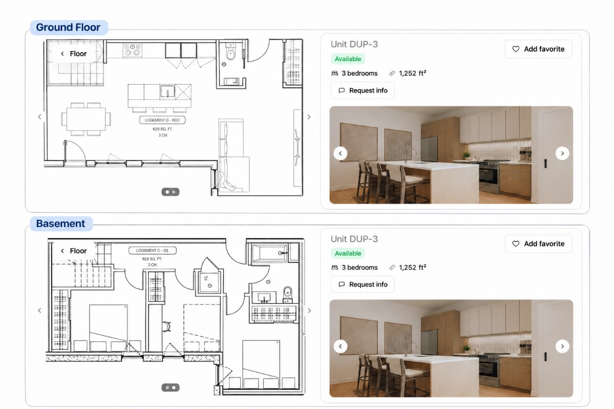

Some homes extend across multiple floors while forming a single unit. A duplex, for example, may have its living area on the ground floor and its bedrooms in the basement.

The **Multi-Level** setting in Planpoint lets you connect a unit to the additional floor it occupies. Combined with a layout for each level, this helps visitors understand where the unit extends and how its spaces are arranged.

Use this feature when adding duplexes or other units that span more than one floor. The unit stays a single unit in your list and in the viewer, so its price, availability and other details are managed in one place.

<Note>Each unit can be connected to **one** additional floor. For a unit that spans three levels, connect the level that matters most to visitors and add the layouts for all three levels (see Step 4).</Note>

<Steps>
  <Step title="Create your unit">
    Start by creating the unit on its main floor and entering its details, such as its name, number of bedrooms, price and availability. See [Units](/units) for how to add units.

    Treat it as one complete property: the information should describe the entire unit across all its levels. For example, enter the total area and the total number of bedrooms.

    If a duplex spans the ground floor and the basement, create it on the ground floor. You will connect it to the basement in the next step.
  </Step>

  <Step title="Connect the additional floor">
    In the **Units** tab, click the unit's edit icon to open its settings. Locate the **Multi-Level** field and select the additional floor the unit occupies. The list shows your project's floors by the names you gave them in the [Floors](/floors) tab, excluding the unit's own floor.

    For a duplex spanning the ground floor and the basement, select the basement floor, called **Sous-sol** in the example below. To remove the connection later, select **None**.

    <Frame caption="The Multi-Level field connects the unit to its second floor.">
      
    </Frame>

    <Info>The **Multi-Level** field is not available for unit models, amenities or parking spaces.</Info>
  </Step>

  <Step title="Draw the unit's outline on the additional floor (optional)">
    By default, the unit can only be hovered and clicked on its main floor. To make it appear on the additional floor's plan as well, go to the **Floors** tab and find that floor. The unit is listed under that floor with "(duplex, primary: …)" and the name of its main floor after its unit name, for example **Unit DUP-3 (duplex, primary: Ground Floor)**.

    Click **Draw outline here** and trace the part of the unit located on this floor, the same way you would [draw a floorplan](/floors). Use **Redraw outline here** to adjust it, or **Reset** to remove it.

    On the additional floor, visitors will then see the unit highlighted with the note "Duplex, primarily on" followed by the main floor's name, and clicking it opens the unit.
  </Step>

  <Step title="Add layouts for every level">
    Connecting the floors tells visitors where the unit extends. Adding the layouts helps them understand the space on each level.

    In the **Units** tab, click the unit's layout icon to open the **Update layout** window. Upload the layouts with **+ new layout** or by dragging them into the window, or select existing layouts from your media library.

    Add all layouts to the same unit:

    - For a duplex, include the layouts for both levels.
    - For a unit spanning three levels, include the layouts for all three levels.

    Drag the layouts to set their order. The viewer shows them in the same order, so place the main floor first.

    <Tip>The viewer does not display a caption under each layout. Use plans that show the level's name on the drawing itself, such as **Ground Floor** or **Basement**, so visitors can easily tell them apart.</Tip>
  </Step>

  <Step title="See how it appears in the viewer">
    In the viewer, hovering over the unit on its main floor displays a tooltip with its name, bedroom count and "Duplex, also on" followed by the name of the connected floor.

    This lets visitors immediately recognize that the highlighted space is part of a larger unit extending onto another floor.

    <Frame caption="The tooltip shows which other floor the unit extends onto.">
      
    </Frame>

    When visitors open the additional floor, a note above the unit list tells them which duplex units also extend onto it and on which floor they are listed.

    Visitors can then open the unit and browse its layouts to explore each level and get a complete picture of the property.

    <Frame caption="The same unit with the layout of each level, shown one after the other in the unit's layout carousel.">
      
    </Frame>
  </Step>
</Steps>

<Tip>Remember that you can always see your work-in-progress in the **[Style and Embed](/preview-embed)** tab.</Tip>

## Troubleshooting

<AccordionGroup>
  <Accordion title="The tooltip does not mention the other floor.">
    Check that the unit's **Multi-Level** field is set to a floor other than **None**, then refresh the page.
  </Accordion>

  <Accordion title="The unit does not appear on the additional floor's plan.">
    Connecting the floor is not enough on its own. Draw the unit's outline on that floor as described in Step 3.
  </Accordion>

  <Accordion title="Only one layout appears for the unit.">
    Check that all layouts were added in the unit's **Update layout** window. If they were and only one still shows, contact us.
  </Accordion>
</AccordionGroup>
